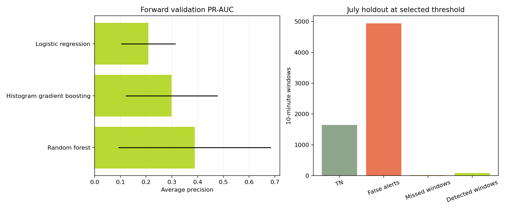
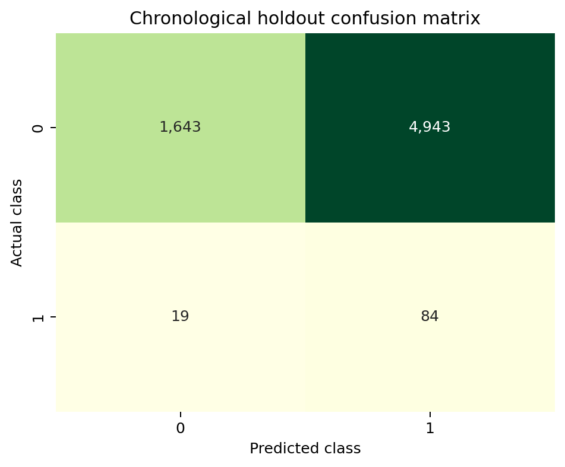

# Metro Compressor Predictive Maintenance

An end-to-end machine-learning project using **real operational telemetry** from a metro train’s air-production-unit compressor. It forecasts whether a documented failure will begin within the next 24 hours and evaluates performance with forward-in-time event validation.

## Why this project is credible

- Uses 1.5M+ real sensor readings from an operating metro compressor
- Converts raw telemetry into leakage-safe 10-minute condition windows
- Engineers rolling variability and one-hour degradation features
- Compares three model families on future failure events
- Tunes the alert threshold only on development-period events
- Reserves the final July incident as an untouched chronological holdout
- Reports rare-event metrics and operational lead time—not accuracy alone
- Provides a Flask dashboard and machine-readable metrics endpoint

## Dataset

[MetroPT-3](https://archive.ics.uci.edu/dataset/791/metropt%2B3%2B) contains pressure, temperature, motor-current, and valve-state readings collected from February through August 2020. UCI documents four high-stress air-leak incidents, which this project uses to construct pre-failure labels.

- Source: UCI Machine Learning Repository
- DOI: [10.24432/C5VW3R](https://doi.org/10.24432/C5VW3R)
- License: CC BY 4.0
- Raw size: approximately 208 MB

Citation: Davari, N., Veloso, B., Ribeiro, R., & Gama, J. (2021), *MetroPT-3 Dataset*.

## Prediction target

Each 10-minute window is labelled positive when it falls within the **24 hours before a documented failure begins**. Samples inside the failure interval are removed: the model must forecast the incident rather than recognize equipment that is already failing.

## Evaluation design

Random splitting would leak neighboring time windows across train and test sets. This project instead uses an event-based temporal design:

1. Train only on history available before each validation incident.
2. Validate forward on documented failure events 2 and 3.
3. Select the best model using mean event-validation PR-AUC.
4. Select an F2-oriented alert threshold from pooled validation predictions.
5. Refit on all development data ending July 8.
6. Evaluate once on the untouched July 15 failure and subsequent holdout period.

Reported holdout metrics include PR-AUC, ROC-AUC, precision, recall, F1, F2, balanced accuracy, Brier score, confusion counts, event detection, and alert lead time.

## Models compared

- Class-weighted logistic regression
- Class-weighted random forest
- Class-weighted histogram gradient boosting

All imputation and scaling steps live inside scikit-learn pipelines and are refitted independently for every temporal fold.

## Model evaluation

The random forest achieved the highest mean PR-AUC across the two forward validation events and was selected for the final holdout evaluation.

| Model | Validation PR-AUC (mean ± SD) | Validation ROC-AUC (mean ± SD) |
| --- | ---: | ---: |
| Random forest | **0.388 ± 0.296** | 0.510 ± 0.222 |
| Histogram gradient boosting | 0.299 ± 0.179 | **0.558 ± 0.077** |
| Logistic regression | 0.209 ± 0.105 | 0.474 ± 0.094 |



*Forward-validation performance varies substantially between the two development events. On the July holdout, the recall-oriented threshold detects most positive windows but also generates many false alerts.*

The alert threshold was selected exclusively from pooled validation predictions by maximizing F2, which weights recall more heavily than precision. The resulting threshold was `0.02` (validation F2: `0.403`). Applied once to the untouched July holdout, it produced:

| Holdout metric | Result |
| --- | ---: |
| PR-AUC | 0.012 |
| ROC-AUC | 0.439 |
| Precision | 1.67% |
| Recall | 81.55% |
| F1 / F2 | 0.033 / 0.077 |
| Balanced accuracy | 0.533 |
| Brier score | 0.021 |
| Confusion matrix (TN / FP / FN / TP) | 1,643 / 4,943 / 19 / 84 |



*The chronological holdout confusion matrix makes the operating trade-off explicit: high recall comes at the cost of a large false-positive workload.*

The model detected the held-out failure, with its first positive window appearing approximately 166.8 hours before the documented incident. However, the very low precision and 4,943 false-positive windows mean the current output is not suitable for automatic maintenance decisions. Consecutive positive windows should first be consolidated into alert episodes, and the approach needs validation on substantially more independent failures. These results are best read as a transparent case study in rare-event evaluation, not as evidence of production readiness.

## Setup

The repository includes a project-local virtual environment at `.venv` (excluded from Git).

```powershell
python -m venv .venv
.venv\Scripts\python -m pip install -r requirements.txt
```

## Run the analysis

```powershell
.venv\Scripts\python train.py
```

The first run downloads the official UCI archive and creates:

- `artifacts/cv_results.csv`
- `artifacts/metrics.json`
- `artifacts/confusion_matrix.png`
- `artifacts/best_model.joblib`

## Run the Python dashboard

```powershell
.venv\Scripts\python app.py
```

Open `http://127.0.0.1:8501`. Evaluated results are also available as JSON at `/api/metrics`.

## Project structure

```text
├── app.py                  # Flask results dashboard and metrics API
├── train.py                # Reproducible training entry point
├── src/
│   ├── data.py             # UCI download and schema validation
│   ├── features.py         # Time aggregation and pre-failure labels
│   └── evaluate.py         # Temporal CV, thresholding, holdout evaluation
├── tests/
│   └── test_features.py    # Label-window leakage test
├── artifacts/              # Generated metrics, plot, and model
├── data/raw/               # Downloaded CSV (Git-ignored)
└── dist/                   # Recruiter-facing portfolio website
```

## Limitations

- Only four documented failure incidents are available, so uncertainty is substantial.
- Labels derive from maintenance reports and may not capture every degraded operating period.
- Adjacent 10-minute windows are correlated; event-level validation mitigates but does not eliminate this limitation.
- Before production use, the system needs additional assets, cost-based thresholding, calibration monitoring, drift detection, and prospective validation.
