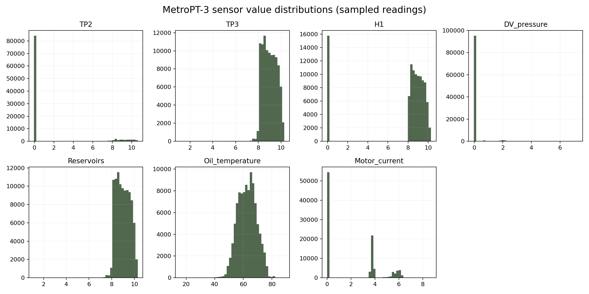
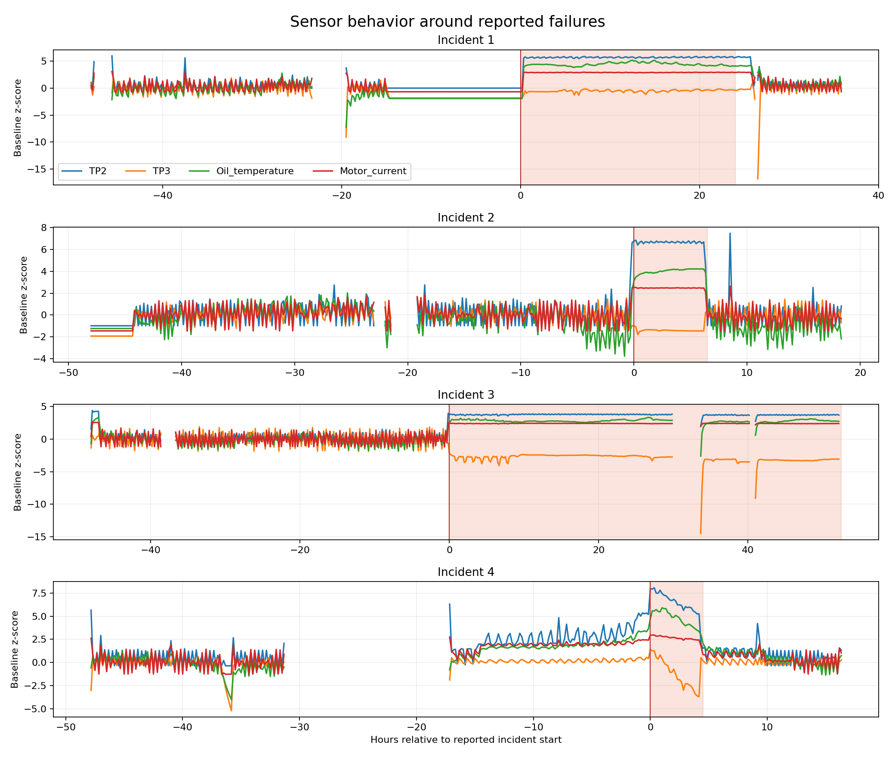
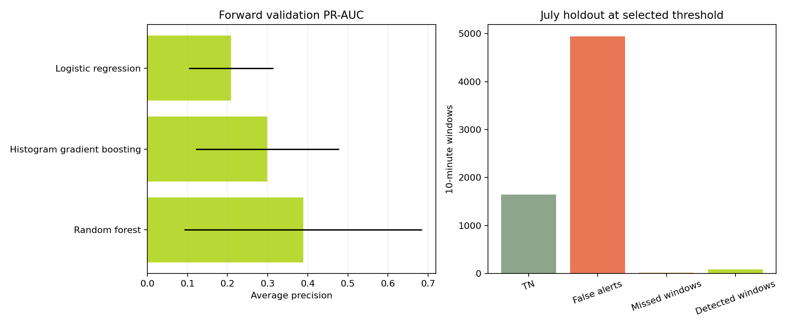

# MetroPT-3 Exploratory Data Analysis

## Purpose

This analysis looks for useful structure in the recorded compressor telemetry and checks whether the data provides enough evidence for reliable failure warnings. It describes associations and data quality; the small number of incidents does not support causal claims.

## Dataset coverage and quality

- **1,516,948 rows** and 17 columns.
- Coverage runs from **2020-02-01 00:00 to 2020-09-01 03:59:50**.
- The source file reports **zero missing values** in every column.
- Readings are nominally about one per 10 seconds in the delivered file (about 0.1 Hz; this is not 1 Hz).
- The model pipeline aggregates these records into **25,594 usable ten-minute windows** after feature engineering and removal of active failure intervals.
- The data describes one compressor. A large row count gives detailed operating history, but does not replace having more independent failures or more machines.

## Sensor distributions

| Sensor | Unit | Mean | Median | 5th–95th percentile | What stands out |
|---|---:|---:|---:|---:|---|
| TP2 | bar | 1.368 | -0.012 | -0.016–9.590 | Strongly bimodal / operating-state dependent; mean is not a typical pressure state. |
| TP3 | bar | 8.985 | 8.960 | 8.138–9.980 | Usually near reservoir pressure, with a relatively narrow central range. |
| H1 | bar | 7.568 | 8.784 | -0.014–9.916 | Broad state changes and near-zero readings pull the average down. |
| DV_pressure | bar | 0.056 | -0.020 | -0.024–-0.008 | Mostly near zero, with occasional large discharge-related changes. |
| Reservoirs | bar | 8.985 | 8.960 | 8.140–9.978 | Closely tracks TP3 in aggregate; useful to examine their difference over time. |
| Oil_temperature | °C | 62.644 | 62.700 | 52.325–73.525 | Thermal state spans a broad but operationally plausible range. |
| Motor_current | A | 2.050 | 0.045 | 0.038–5.987 | Highly state-dependent; zero/idle-like readings dominate the median. |

The unusual distributions make the dashboard’s time-series view more informative than a single average. Operating mode matters: for example, low motor current can be normal when the compressor is off or unloaded.

## What changes before the reported incidents?

For each incident, I compared the raw sensor mean in the 24 hours before its reported start with the preceding six days. This is a descriptive comparison only. It is not a significance test, and windows/sensor readings are autocorrelated.

| Event | TP2 | TP3 | H1 | DV pressure | Reservoir | Oil temp | Motor current |
|---|---:|---:|---:|---:|---:|---:|---:|
| Apr 18 | -88% | -7% | +13% | -113%* | -7% | -14% | -77% |
| May 29 | +22% | +3% | +1% | -537%* | +3% | ~0% | +22% |
| Jun 5 | -34% | ~0% | +8% | -99%* | ~0% | -2% | -16% |
| Jul 15 | +143% | +1% | -26% | -69%* | +1% | +7% | +71% |

Percent change is not meaningful for `DV_pressure` because the baseline mean is near zero and can be negative; the large percentages marked * are denominator artifacts. Compare absolute levels and traces in the dashboard instead. TP2 and motor-current direction differs across incidents, which cautions against a simple universal threshold. Similar TP3 and reservoir averages do not establish there is no useful signal; event sample size is tiny and short-lived changes can vanish in averages.

## Model analysis

The model target is “a documented air leak begins within the next 24 hours.” The inputs are 10-minute mean, within-window standard deviation, and one-hour change for seven analog sensors. Three class-weighted models were compared: logistic regression, random forest, and histogram gradient boosting. Random forest had the best mean PR-AUC in two forward validation incidents, but the variation was large and only two events informed selection.

On the chronological July holdout, the random forest scored:

- **PR-AUC 0.0125**; positive-window prevalence is about 1.54% (103 / 6,689), so ranking is approximately baseline-level.
- **Recall 81.6%:** 84 of 103 labeled windows were flagged.
- **Precision 1.67%:** 84 of 5,027 flagged windows were labeled positive.
- **4,943 false-positive windows**, or about 60 such windows per positive window.
- **19 missed positive windows.**

Those are ten-minute windows, not separate alerts or work orders. A contiguous alarm period could account for many windows, so operational burden must be assessed after merging windows into episodes. The first prediction above threshold was about 167 hours before the failure, outside the stated 24-hour forecast window; that is likely persistent alerting and cannot be presented as actionable seven-day warning.

## Interpretation and decisions

There are four documented failures total, only two earlier incidents for validation and one incident in the final holdout. The model’s scores do not provide a reliable estimate of future fleet performance. The low PR-AUC and precision say that the current alert scores do not distinguish the positive windows well enough for automatic work orders.

Recommended next use:

1. Keep this as an offline analysis and learning baseline.
2. Group adjacent flagged windows into alert episodes and report episodes per week, episode duration, and lead time relative to the 24-hour target.
3. Review episodes with maintenance engineers in shadow mode; capture confirmed defects, inspections, repairs, and non-actionable alerts.
4. Compare with current scheduled/condition-based maintenance.
5. Collect more incidents and preferably data from additional compressors before estimating reliability or business value.
6. Add downtime, inspection, and repair costs before calculating a financial case.

The present data cannot quantify savings or prove a cause of failure. It can support sensor exploration, hypothesis generation, and planning a prospective evaluation.
